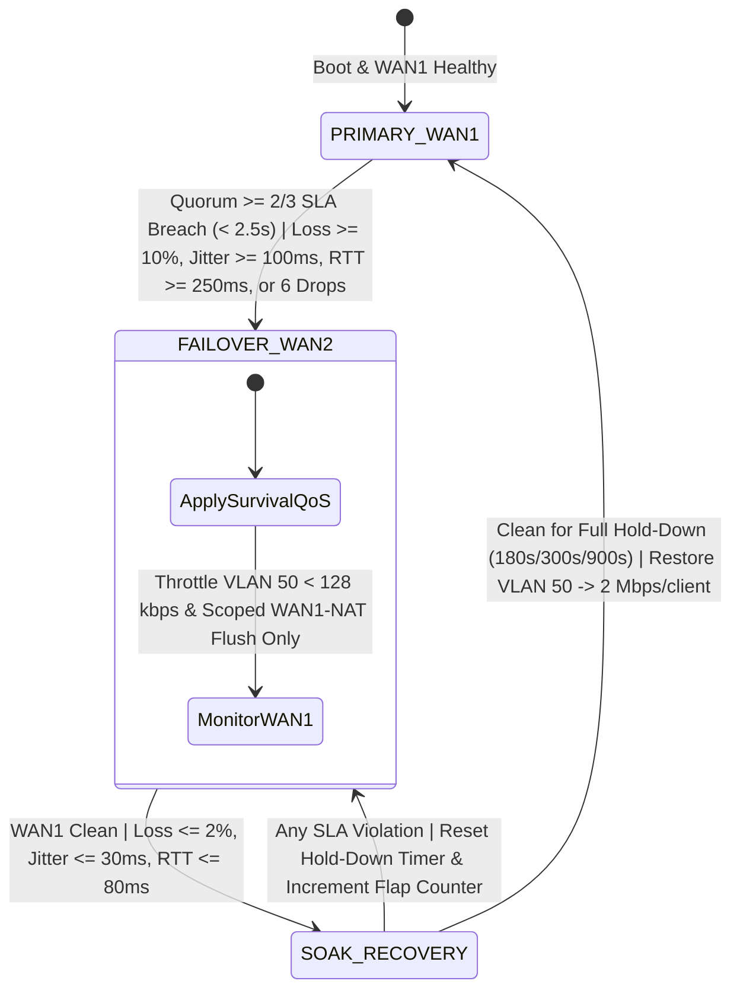

# Arsitektur Jaringan — Easy Rent Bali (Kuta Hub)

> **Assessment Track:** Track C — *The Kuta Sunset Outage* (Fase 1: Network Architecture & Resilience Design)  
> **Lokasi Target:** Kuta Hub (Branch Operations) ↔ HQ Renon (Denpasar) ↔ Cloud Management  
> **Target SLA:** Failover `< 3 detik`, Zero Payment Drop (POS/Kiosk), Proteksi Kuota WAN2 Cellular  

---

## Ringkasan Eksekutif

Insiden **"The Kuta Sunset Outage"** terjadi saat jam sibuk sore hingga malam (17:00–21:00 WITA) di area Kuta, di mana jalur fiber utama (WAN1) tidak selalu putus total (*hard down*), melainkan mengalami degradasi berat (*brownout*) berupa **jitter > 400 ms** dan **packet loss 18%**. Kondisi ini menyebabkan:
1. Transaksi POS/Kiosk dan mesin EDC *timeout* karena antrean trafik tercampur dengan trafik Guest Wi-Fi.
2. Mekanisme failover konvensional (*simple ping down*) gagal berpindah ke WAN2 karena paket ICMP masih sesekali lolos.
3. Saat berpindah ke WAN2 (Cellular 4G/5G Backup), trafik turis pada Guest Wi-Fi langsung menghabiskan bandwidth dan kuota seluler.

Dokumen ini menetapkan arsitektur jaringan ter-segmentasi berbasis **802.1Q VLAN**, **QoS end-to-end**, **Dual-WAN SLA-Based Failover (< 3 detik)** dengan **anti-flapping**, serta **otomasi throttling VLAN 50 (< 128 kbps)** ketika sistem beroperasi pada mode *WAN2 Cellular Survival*.

---

## 1. Topologi Jaringan (Kuta Hub ↔ HQ Renon ↔ Cloud Management)

### 1.1 Diagram Topologi (Mermaid.js)

```mermaid
flowchart TB
    subgraph CLOUD["Cloud Management & External Services"]
        direction LR
        CTRL["Cloud Network Controller / SD-WAN Orchestrator & SIEM"]
        PAY["Payment Gateway & Acquiring API (HTTPS/TLS)"]
        FLEET_API["Fleet Telematics & Smart-Locker Cloud API"]
        INET["Public Internet & Anycast DNS (1.1.1.1 / 8.8.8.8)"]
    end

    subgraph HQ["HQ Renon (Denpasar)"]
        direction TB
        HQ_FW["HQ Edge Firewall / VPN Concentrator (Dual-ISP)"]
        subgraph HQ_CORE["HQ Internal Services"]
            direction LR
            ERP["Core Booking & ERP Database"]
            IAM["RADIUS / AD / Auth Server"]
            NOC["NOC Bastion / Jump Host (Admin VLAN 10)"]
            VMS["Central VMS / NVR Archive"]
        end
        HQ_FW --> ERP
        HQ_FW --> IAM
        HQ_FW --> NOC
        HQ_FW --> VMS
    end

    subgraph WAN_LAYER["WAN Transport & SD-WAN Overlay"]
        direction LR
        ISP1["WAN1: Dedicated Business Fiber (Primary - 200 Mbps)"]
        ISP2["WAN2: 4G/5G Business Cellular Modem (Backup - Metered)"]
    end

    subgraph KUTA["Kuta Hub (Branch Site - Easy Rent Bali)"]
        direction TB
        GW["Kuta Edge Firewall / SD-WAN Gateway (SLA Probe + Auto-QoS)"]
        SW["Core Managed L2/L3 PoE+ Switch (802.1Q Trunking)"]
        AP["Enterprise Wi-Fi 6 AP Cluster (Multi-SSID + Client Isolation)"]

        subgraph VLANS["802.1Q Segmented Zones"]
            direction LR
            V10["VLAN 10: Mgmt (10.10.10.0/24) - Switches, APs, UPS, OOB"]
            V20["VLAN 20: POS/Kiosk (10.10.20.0/24) - POS, Kiosk, EDC (DSCP EF)"]
            V30["VLAN 30: Staff (10.10.30.0/24) - Front-Desk PC, Laptops, VoIP"]
            V40["VLAN 40: Fleet IoT/CCTV (10.10.40.0/24) - NVR, IP Cam, Key-Locker"]
            V50["VLAN 50: Guest Wi-Fi (172.16.50.0/22) - Tourist Devices (Isolated)"]
        end

        GW <==>|"802.1Q Trunk (VLAN 10,20,30,40,50)"| SW
        SW <==>|"802.1Q Trunk + PoE+"| AP
        SW --- V10
        SW --- V20
        SW --- V30
        SW --- V40
        AP -.->|"SSID: ERB-POS (VLAN 20)"| V20
        AP -.->|"SSID: ERB-Staff (VLAN 30)"| V30
        AP -.->|"SSID: EasyRent-Guest (VLAN 50)"| V50
    end

    GW <==>|"eth0 / WAN1 (Active)"| ISP1
    GW <-.->|"eth1 / WAN2 (Hot-Standby)"| ISP2

    ISP1 <==>|"Primary IPSec / WireGuard Tunnel (BFD/DPD)"| HQ_FW
    ISP2 <-.->|"Backup IPSec / WireGuard Tunnel (Warm-Standby)"| HQ_FW

    ISP1 <==> CLOUD
    ISP2 <-.->|"Survival Mode: POS + Mgmt + IoT Telemetry Only"| CLOUD
    HQ_FW <==> CTRL
```



---

### 1.2 Diagram Topologi (ASCII)

```text
+---------------------------------------------------------------------------------------------------+
|                             CLOUD MANAGEMENT & EXTERNAL SERVICES                                  |
|  +-----------------------+  +------------------------+  +-------------------+  +---------------+  |
|  | Cloud SD-WAN / NOC    |  | Payment Gateway / EDC  |  | Fleet Telematics  |  | Public Inet & |  |
|  | Controller & SIEM     |  | Acquiring APIs (TLS)   |  | & Key-Locker API  |  | 1.1.1.1/8.8.8.8|  |
|  +-----------+-----------+  +-----------+------------+  +---------+---------+  +-------+-------+  |
+--------------|--------------------------|-------------------------|--------------------|----------+
               |                          |                         |                    |
               +--------------------------+------------+------------+--------------------+
                                                       |
                +--------------------------------------+--------------------------------------+
                |                                                                             |
                v                                                                             v
+-------------------------------+                                       +---------------------------------------+
|     HQ RENON (DENPASAR)       |                                       |      WAN TRANSPORT / ISP LAYER        |
| +---------------------------+ |   Primary WireGuard/IPSec Tunnel      |  +---------------------------------+  |
| | HQ Edge Firewall / VPN    |<==========================================>| WAN1: Business Fiber (Primary)  |  |
| | Concentrator (Dual-ISP)   | |   Backup WireGuard/IPSec Tunnel       |  | 200 Mbps Sym | Static/PPPoE     |  |
| +-------------+-------------+ |< - - - - - - - - - - - - - - - - - - - - +----------------+----------------+  |
|               |               |                                       |                   |                   |
|   +-----------+-----------+   |                                       |  +----------------+----------------+  |
|   |       |       |       |   |                                       |  | WAN2: 4G/5G Cellular (Backup)   |  |
|   v       v       v       v   |                                       |  | Metered | Survival QoS Profile  |  |
| [ERP/DB] [IAM]  [NOC]  [VMS]  |                                       |  +----------------+----------------+  |
|                 Bastion       |                                       +-------------------|-------------------+
+-------------------------------+                                                           |
                                                                          WAN1 (Active) === | === WAN2 (Standby)
                                                                                            v
+---------------------------------------------------------------------------------------------------------------+
|                                     KUTA HUB (BRANCH SITE - EASY RENT BALI)                                   |
|                                                                                                               |
|                               +-----------------------------------------------+                               |
|                               |   Kuta Edge Firewall / SD-WAN Gateway         |                               |
|                               |   - Dual-WAN SLA Engine (250ms Probe)         |                               |
|                               |   - Stateful Zone Firewall & NAT              |                               |
|                               |   - Dynamic QoS / Auto-Throttle Hook          |                               |
|                               |   - Gateways: .10.1 / .20.1 / .30.1 / .40.1   |                               |
|                               |               & 172.16.50.1                   |                               |
|                               +-----------------------+-----------------------+                               |
|                                                       |                                                       |
|                                                       | 802.1Q Trunk (Tagged: 10,20,30,40,50)                 |
|                                                       | Native VLAN: 999 (Blackhole/Unused)                   |
|                                                       v                                                       |
|                               +-----------------------------------------------+                               |
|                               |     Core Managed L2/L3 PoE+ Switch (24/48p)   |                               |
|                               |     - 802.1p CoS Trust / DSCP Marking         |                               |
|                               |     - DHCP Snooping, DAI, Port Security       |                               |
|                               +----+----------+-----------+----------+--------+                               |
|                                    |          |           |          |                                        |
|          +-------------------------+          |           |          +-------------------------+              |
|          | Access VLAN 10                     | Access    | Access                             | Trunk + PoE+ |
|          v                                    v VLAN 20   v VLAN 40                            v              |
| +------------------+                +------------------+ +------------------+        +--------------------+   |
| | VLAN 10: Mgmt    |                | VLAN 20: POS/Ksk | | VLAN 40: IoT/Cam |        | Wi-Fi 6 AP Cluster |   |
| | 10.10.10.0/24    |                | 10.10.20.0/24    | | 10.10.40.0/24    |        | Mgmt: VLAN 10      |   |
| | - Switch/AP/UPS  |                | - POS Terminals  | | - Local NVR      |        +---+------+------+--+   |
| | - OOB/Syslog     |                | - Check-in Kiosk | | - IP CCTV Cams   |            |      |      |      |
| | [DSCP CS6]       |                | - EDC & Printers | | - Smart Lockers  |     SSID   | SSID | SSID |      |
| +------------------+                | [DSCP EF / Prio1]| | - Fleet GPS Dock |    ERB-POS |Staff |Guest |      |
|                                     +------------------+ | [No Pub Ingress] |   (VLAN 20)| (30) | (50) |      |
|                                                          +------------------+            v      v      v      |
|                                                                                     [Handheld][Staff][Guest]  |
|                                                                                      POS/EDC  Laptops Wi-Fi   |
|                                                                                              10.10.30 172.16  |
|                                                                                               .0/24   .50.0/22|
|                                                                                                      [Isolated|
|                                                                                                      2M ->    |
|                                                                                                      <128kbps]|
+---------------------------------------------------------------------------------------------------------------+
```

### 1.3 Komponen & Alur Komunikasi Kunci
1. **Kuta Hub ↔ HQ Renon (Control & Business Plane):**
   - Dihubungkan melalui **Dual Site-to-Site VPN (WireGuard atau IPSec IKEv2)** dengan mode *Active/Warm-Standby* (Tunnel 1 terikat pada WAN1, Tunnel 2 terikat pada WAN2).
   - BGP/OSPF atau *route-based SD-WAN* di atas tunnel memindahkan trafik ERP, autentikasi RADIUS, dan akses NOC secara otomatis dalam `< 3 detik` tanpa menunggu re-negosiasi fase IKE dari nol.
2. **Kuta Hub ↔ Cloud Management (Observability & Orchestration Plane):**
   - Seluruh perangkat pada **VLAN 10** melapor secara terenkripsi (`TLS 1.3 / HTTPS`, `Syslog-over-TLS`, `SNMPv3` melalui tunnel) ke Cloud Network Controller & SIEM.
   - Akses manajemen tidak pernah mengekspos port SSH/WebUI ke IP publik WAN.
3. **Direct Internet Breakout (DIA) vs VPN Backhaul:**
   - **VLAN 20 (POS/Kiosk):** Akses ke Payment Gateway dilakukan via *Direct Internet Breakout* (latensi terendah, diprioritaskan DSCP EF), sedangkan sinkronisasi booking/invoice lokal mengarah ke HQ Renon melalui VPN.
   - **VLAN 50 (Guest Wi-Fi):** Seluruh trafik keluar langsung ke Public Internet (DIA), sepenuhnya terisolasi dari tunnel HQ Renon dan seluruh subnet privat RFC 1918.

---

## 2. 802.1Q VLAN Matrix & Segmentasi Keamanan

### 2.1 Tabel 802.1Q VLAN Matrix

| VLAN ID | Nama / Zona | Subnet & Gateway | DHCP Scope & Lease | Priority / QoS (DSCP & 802.1p) | Kebijakan Bandwidth (WAN1 Normal vs WAN2 Failover) | Aturan Inter-VLAN Routing & Keamanan |
| :---: | :--- | :--- | :--- | :--- | :--- | :--- |
| **10** | **Mgmt** *(Infrastructure)* | `10.10.10.0/24`<br>GW: `10.10.10.1`<br>Mask: `255.255.255.0` | **Static Preferred**<br>Static: `.2–.199`<br>ZTP Pool: `10.10.10.200–220` *(MAC-bound, Lease 24h)* | **DSCP CS6 (48)**<br>**802.1p CoS 6**<br>*(Network Control — High)* | **WAN1:** Guaranteed min `2 Mbps`<br>**WAN2:** Guaranteed min `512 kbps` *(Unthrottled control traffic)* | **Inbound:** **DENY ALL** dari VLAN 20, 30, 40, 50. Hanya boleh diakses dari **HQ Renon NOC Bastion** via VPN (SSH/HTTPS/SNMPv3 + MFA).<br>**Outbound:** Allow ke Cloud Controller, NTP, DNS, Syslog. |
| **20** | **POS / Kiosk** *(Payment & Checkout)* | `10.10.20.0/24`<br>GW: `10.10.20.1`<br>Mask: `255.255.255.0` | `10.10.20.100–200`<br>Static/Reserved: `.10–.99` *(POS, Kiosk, EDC, Printer)*<br>Lease: `24 jam` | **DSCP EF (46)**<br>**802.1p CoS 5**<br>*(Strict Priority / LLQ — Tier 1)* | **WAN1:** Strict Priority, guaranteed min `10 Mbps`<br>**WAN2:** **Strict Priority (Unthrottled)**, guaranteed min `2 Mbps` | **PCI-Style Isolation:** **DENY** ke/dari VLAN 10, 30, 40, 50.<br>**Allow:** Outbound HTTPS (443) ke Payment Gateway & Cloud POS API, port spesifik ERP HQ Renon via VPN, DNS/NTP lokal (`.1`). Intra-VLAN dibatasi (hanya POS → Thermal Printer). |
| **30** | **Staff** *(Operations & Backoffice)* | `10.10.30.0/24`<br>GW: `10.10.30.1`<br>Mask: `255.255.255.0` | `10.10.30.50–220`<br>Reserved: `.10–.49` *(Office Printer, VoIP)*<br>Lease: `8 jam` | **DSCP AF21 (18)**<br>**802.1p CoS 3**<br>*(VoIP sub-class: DSCP EF)* | **WAN1:** Max `50 Mbps` shared<br>**WAN2:** Shaped max `4 Mbps` aggregate *(Block video streaming & OS update)* | **Allow:** Outbound Internet (DNS filtering aktif), akses aplikasi internal HQ Renon via VPN, akses *read-only* HTTPS/RTSP ke NVR VLAN 40 khusus IP Front-Desk Manager.<br>**Deny:** VLAN 10, VLAN 20, VLAN 50, dan sensor IoT VLAN 40. |
| **40** | **Fleet IoT / CCTV** *(OT & Security)* | `10.10.40.0/24`<br>GW: `10.10.40.1`<br>Mask: `255.255.255.0` | `10.10.40.100–200`<br>Static: `.10–.50` *(NVR, Smart Key Locker)*, `.51–.99` *(IP CCTV)*<br>Lease: `24 jam` | **Fleet IoT:** `DSCP AF11 (10)` / CoS 2<br>**CCTV Sync:** `DSCP CS1 (8)` / CoS 1 | **WAN1:** IoT `5 Mbps`, CCTV sync max `15 Mbps`<br>**WAN2:** IoT telemetry aktif (`1 Mbps`); **CCTV Cloud Upload di-pause/cap `< 256 kbps`** *(NVR lokal tetap rekam)* | **NO PUBLIC INGRESS (Strict):** Zero Port Forwarding, UPnP Disabled, Drop semua inbound WAN.<br>**Outbound:** Hanya Allowlist MQTT-TLS (8883)/HTTPS (443) dari Smart Locker & Fleet Gateway ke Cloud API. Kamera CCTV **diblokir dari Internet** (hanya kirim stream ke NVR lokal). Remote view NVR hanya via HQ VPN.<br>**Deny:** VLAN 10, 20, 30, 50. |
| **50** | **Guest Wi-Fi** *(Customer Hotspot)* | `172.16.50.0/22`<br>GW: `172.16.50.1`<br>Range: `172.16.50.1–172.16.53.254` *(1.022 hosts)* | `172.16.50.10–172.16.53.250`<br>Lease: **`60 menit`** *(short lease untuk turnover turis tinggi)* | **DSCP CS0 (0)** *(Normal)*<br>**DSCP CS1 (8)** *(Failover — Scavenger)*<br>**802.1p CoS 0** | **WAN1:** **2 Mbps / client** *(Up/Down PCQ)*, ceiling aggregate `60 Mbps`<br>**WAN2:** **Auto-Throttled `< 128 kbps`** *(64–96 kbps/client, hard aggregate cap 120 kbps)* | **Full L2 & L3 Client Isolation** *(AP Isolation + Switch Protected Port + Firewall)*.<br>**Allow:** Public Internet (HTTP/HTTPS/DNS eksternal `1.1.1.1`/`8.8.8.8`).<br>**Explicit DENY:** Seluruh subnet RFC 1918 (`10.0.0.0/8`, `172.16.0.0/12`, `192.168.0.0/16`), VLAN 10/20/30/40, HQ Renon VPN, dan Management UI Gateway. |

> **Catatan Native VLAN Security:** Seluruh link *802.1Q Trunk* (Gateway ↔ Switch ↔ Access Points) menggunakan **VLAN 999 (Blackhole / Unused)** sebagai *Native VLAN* (`switchport trunk native vlan 999`) dengan *untagged frames* di-drop untuk mencegah serangan *VLAN Hopping (Double Tagging)*.

---

### 2.2 Matriks Kebijakan Inter-VLAN Firewall (Default-Deny)

| Source \ Destination | VLAN 10 (Mgmt) | VLAN 20 (POS) | VLAN 30 (Staff) | VLAN 40 (IoT/CCTV) | VLAN 50 (Guest) | HQ Renon (VPN) | Public Internet |
| :--- | :---: | :---: | :---: | :---: | :---: | :---: | :---: |
| **VLAN 10 (Mgmt)** | Allow (Intra) | Deny | Deny | Deny | Deny | Allow (NOC/Syslog) | Allow (Ctrl/NTP Only) |
| **VLAN 20 (POS/Kiosk)** | Deny | Restricted* | Deny | Deny | Deny | Allow (ERP Port Only) | Allow (Payment/POS API) |
| **VLAN 30 (Staff)** | Deny | Deny | Allow (Intra) | NVR RO Only** | Deny | Allow (App/AD/File) | Allow (Filtered) |
| **VLAN 40 (IoT/CCTV)** | Deny | Deny | Deny | Local NVR Only | Deny | Allow (VMS Archive) | IoT Allowlist Only*** |
| **VLAN 50 (Guest)** | **DENY** | **DENY** | **DENY** | **DENY** | **ISOLATED** | **DENY** | Allow (Throttled) |
| **HQ Renon (VPN)** | Allow (NOC Only) | Allow (ERP Sync) | Allow (Mgmt/AD) | Allow (VMS Pull) | **DENY** | — | — |
| **Public Internet (WAN)** | **DENY** | **DENY** | **DENY** | **DENY (No Ingress)** | **DENY** | — | — |

*\*Restricted: Hanya POS Terminal ↔ Thermal Receipt Printer pada port TCP 9100; antar terminal POS/EDC diblokir.*  
*\*\*NVR RO Only: Hanya IP workstation Manager/Front-Desk yang diizinkan mengakses WebUI/RTSP NVR (`10.10.40.10`).*  
*\*\*\*IoT Allowlist Only: Kamera IP CCTV tidak memiliki akses keluar internet; hanya IoT Gateway & Smart Key Locker yang diizinkan ke FQDN/IP Fleet Cloud API.*

---

### 2.3 Mapping Wireless SSID & Keamanan Layer-2

| SSID | Mapped VLAN | Autentikasi & Enkripsi | Proteksi L2 / Radio |
| :--- | :---: | :--- | :--- |
| `ERB-POS-Secure` *(Hidden)* | VLAN 20 | WPA3-Enterprise (802.1X / MAC+Cert) | 5 GHz Only, Airtime Fairness High, Fast Roaming (802.11r/k/v) |
| `ERB-Staff` | VLAN 30 | WPA3-Enterprise (RADIUS HQ Renon) | Dual-Band, DHCP Snooping, Dynamic ARP Inspection (DAI) |
| `EasyRent-Guest` | VLAN 50 | Open + Captive Portal / OWE (Enhanced Open) | **AP Client Isolation ON**, Broadcast/Multicast Drop, Per-Client Rate Limit |

---

## 3. Desain Dual-WAN Failover (< 3 Detik), Anti-Flapping & Auto-Throttling VLAN 50

### 3.1 Mengapa Failover Standar Gagal pada "The Kuta Sunset Outage"

Pada insiden **Kuta Sunset Outage**, WAN1 tidak putus total (link Ethernet tetap *UP* dan IP tetap merespons ping sesekali), melainkan mengalami **brownout**:
- **Packet Loss:** `18%`
- **Jitter:** `> 400 ms`

Jika router hanya menggunakan *basic ping failover* (misal: pindah jika 3 ping berturut-turut gagal), probabilitas 3 ping gagal berturut-turut pada kondisi 18% loss hanyalah:

$$P(\text{3 consecutive drops}) = 0.18^3 = 0.005832 \approx 0.58\%$$

Artinya, router akan **tetap bertahan di WAN1 yang sekarat** sementara sesi TLS Payment Gateway dan POS terus *timeout*. Solusinya adalah **Active SLA-Based Sliding-Window Health Check** yang mengukur **Packet Loss, Latency, dan Jitter** secara simultan dalam jendela waktu pendek (`2.5 detik`).

---

### 3.2 Arsitektur Multi-Target Health Check & SLA Probe (Anti-DNS Blackout)

> **Catatan Kritis Operasional (Pencegahan DNS Blackout):**  
> Melakukan *static `/32` route pinning* ke `1.1.1.1` dan `8.8.8.8` di tabel routing `main` pada WAN1 adalah anti-pattern berbahaya: saat WAN1 mati dan trafik pindah ke WAN2, kueri DNS klien POS/Staff/Guest ke `1.1.1.1`/`8.8.8.8` akan tetap dipaksa masuk ke rute `/32` WAN1 yang mati, menyebabkan **DNS Blackout total**.

Untuk mencegah *false failover* sekaligus menghilangkan risiko **DNS Blackout**, diterapkan pendekatan **Defense-in-Depth** (kombinasi pemisahan IP target khusus + isolasi tabel routing PBR):

1. **Pemisahan IP Probe Khusus (Non-DHCP):**  
   - **DNS Klien (via DHCP / Local DNS Forwarder):** Tetap menggunakan `1.1.1.1` (Primary) & `8.8.8.8` (Secondary) yang mengikuti *default route* aktif di tabel `main` — otomatis berpindah ke WAN2 saat failover.
   - **IP Target Health-Check WAN1 (Eksklusif Probe — TIDAK dibagikan via DHCP):** Menggunakan `1.0.0.1`, `9.9.9.9`, dan endpoint khusus probe HQ Renon (`203.0.113.10`).
2. **Isolated Policy-Based Routing (Routing Table `probe_wan1` & `probe_wan2`):**  
   - **Zero `/32` probe route di tabel `main`.** Seluruh rute probe ditempatkan pada *routing table* terisolasi (`probe_wan1` untuk WAN1, `probe_wan2` untuk WAN2).
   - Hanya paket probe yang berasal dari router sendiri (`chain=output` dengan sumber/tanda probe) yang diberi `routing-mark=probe_wan1`, sehingga trafik klien LAN sama sekali tidak pernah terdampak rute probe.

Dengan aturan **Quorum (`>= 2 dari 3 target melanggar SLA`)**, berikut matriks target health-check WAN1:

| Probe Target (WAN1) | IP / Endpoint (Non-DHCP) | Peran & Alasan Pemilihan | Mekanisme Routing Terisolasi |
| :--- | :--- | :--- | :--- |
| **Target 1 (Primary Anycast)** | **`1.0.0.1`** *(Cloudflare Secondary Anycast)* | Edge terdekat (Denpasar/Jakarta/SG), stabil untuk baseline jitter, **tidak digunakan oleh klien DHCP**. | `routing-table=probe_wan1` → `WAN1_GW` *(PBR `chain=output` only)* |
| **Target 2 (Secondary Anycast)** | **`9.9.9.9`** *(Quad9 Anycast)* | Redundansi jalur transit internasional/peering independen, **tidak digunakan oleh klien DHCP**. | `routing-table=probe_wan1` → `WAN1_GW` *(PBR `chain=output` only)* |
| **Target 3 (Business Anchor)** | **`203.0.113.10`** *(HQ Renon WAN1 Probe/Tunnel 1)* / `10.255.0.1` *(Tunnel 1 Keepalive)* | Memastikan jalur ke **HQ Renon** dan konektivitas domestik Bali sehat (Tunnel 2 WAN2 menggunakan IP HQ sekunder `203.0.113.20`). | `routing-table=probe_wan1` → `WAN1_GW` *(PBR `chain=output` only)* |

> **Catatan Monitoring WAN2:** WAN2 (Cellular) dimonitor secara terpisah melalui `routing-table=probe_wan2` (*low-overhead keepalive*, 1 probe per 2 detik ke `8.8.4.4` & endpoint HQ sekunder `203.0.113.20`) agar kesiapan WAN2 terverifikasi tanpa tumpang tindih dengan DNS klien maupun tabel `main` (< 2 MB/hari).

#### Parameter Probe & SLA Window

| Parameter | Nilai Konfigurasi | Keterangan |
| :--- | :--- | :--- |
| **Protokol Probe** | ICMP Echo + TWAMP-Lite / UDP Echo | Mengukur RTT, Packet Loss, dan RFC 3550 Jitter |
| **Ping Interval** | **`250 ms`** *(4 probe/detik per target)* | Resolusi tinggi untuk mendeteksi brownout dalam `< 3 detik` |
| **Probe Timeout** | **`400 ms`** | Paket dengan RTT `> 400 ms` langsung dihitung sebagai *SLA Miss / Timeout* |
| **Sliding Window** | **`10 probes` (`2.5 detik`)** | Evaluasi berjalan tiap 250 ms atas 10 sampel terakhir |
| **Quorum Trigger** | **`>= 2 dari 3 target`** gagal SLA | Menghindari false failover akibat gangguan 1 target tunggal |

---

### 3.3 Kalkulasi Budget Waktu Failover (< 3 Detik)

#### Skenario A: WAN1 Hard Outage (Fiber Putus Total)
1. **Deteksi (`6` timeout berturut-turut @ 250 ms):** `6 × 250 ms = 1.50 detik`
2. **Route Convergence & SD-WAN Policy Switch:** `~0.20 detik`
3. **Scoped WAN1 NAT Conntrack Flush + QoS Profile Hook:** `~0.25 detik`
4. **Warm-Standby VPN Tunnel Activation (WireGuard/IPSec DPD):** `~0.35 detik`
- **Total Waktu Failover (Hard Outage):** **`~2.30 detik`** (**< 3 detik ✅**)

#### Skenario B: Kuta Sunset Brownout (Jitter > 400 ms & 18% Packet Loss)
1. **Deteksi Sliding Window (`10 probes` @ 250 ms):**
   - Pada `18% packet loss`, rata-rata `>= 2` paket dari `10` hilang (`20% >= threshold 10%`) **ATAU** sampel RTT/jitter langsung melampaui threshold `Jitter >= 100 ms` / `RTT >= 250 ms` dalam **1–2.5 detik** (`<= 2.50 detik`).
2. **Route Switch + Scoped WAN1 NAT Flush + Auto-Throttle VLAN 50 Hook:** `~0.30 detik`
- **Total Waktu Failover (Sunset Brownout):** **`~2.50 – 2.80 detik`** (**< 3 detik ✅**)



---

### 3.4 Mekanisme Anti-Flapping (Hysteresis & Dampening)

Kondisi *Kuta Sunset Outage* sangat fluktuatif: kualitas WAN1 bisa turun ke 18% loss, membaik sesaat selama 10 detik, lalu anjlok lagi. Untuk mencegah *route flapping* yang memutus sesi pembayaran POS, diterapkan 4 lapis proteksi:

1. **Asymmetric SLA Thresholds (Hysteresis Gap):**
   Threshold untuk **keluar dari WAN1 (Failover)** dibuat agresif, sedangkan syarat **kembali ke WAN1 (Failback)** dibuat jauh lebih ketat:

   | Metrik SLA | Trigger Failover (`WAN1 → WAN2`) | Syarat Failback (`WAN2 → WAN1`) | Hysteresis Margin |
   | :--- | :---: | :---: | :---: |
   | **Packet Loss** | `>= 10%` *(menangkap 18% loss)* | `<= 2%` *(ideal 0–1%)* | `8%` gap |
   | **Jitter (RFC 3550)** | `>= 100 ms` *(menangkap >400ms)* | `<= 30 ms` | `70 ms` gap |
   | **Latency (Avg RTT)** | `>= 250 ms` | `<= 80 ms` | `170 ms` gap |
   | **Consecutive Loss** | `>= 6 probes` (`1.5 detik`) | `0 drops` dalam window | Strict clean |

2. **Hold-Down / Soak Timer (`180 Detik`):**
   - Setelah pindah ke WAN2, router **dilarang** melakukan failback sebelum WAN1 terbukti lulus seluruh syarat *Failback* secara **kontinu tanpa satu pun pelanggaran selama 180 detik (3 menit)** berturut-turut.
   - Jika terjadi 1 kali saja spike jitter `> 30 ms` atau packet loss pada detik ke-140, timer otomatis **di-reset ke 0**.

3. **Flap Counter & Exponential Backoff (Dampening):**
   - Sistem menghitung jumlah kejadian failover dalam jendela waktu `30 menit`:
     - **Flap ke-1:** Hold-down timer = **`180 detik` (3 menit)**.
     - **Flap ke-2 (dalam 30 menit):** Hold-down timer naik menjadi **`300 detik` (5 menit)**.
     - **Flap ke-3 (dalam 30 menit):** Hold-down timer dikunci menjadi **`900 detik` (15 menit)** + sistem mengirim **Alert P1 (Webhook/Telegram/SIEM)** ke tim NOC HQ Renon (*"WAN1 Kuta Chronic Instability — Pinned to WAN2"*).

4. **Asymmetric & Scoped Connection Tracking (Conntrack) Handling:**
   - **Saat Failover (`WAN1 → WAN2`) — Scoped WAN1 NAT Flush (DILARANG Global Flush):**
     - Jalankan *conntrack flush* **khusus hanya pada sesi NAT yang keluar melalui interface WAN1** (kondisi `srcnat=yes` dengan `reply-dst-address` mengarah ke IP publik WAN1).
     - **Mengapa bukan Global Flush?** Global flush akan memutus paksa seluruh koneksi lokal non-NAT yang sehat di dalam Kuta Hub, seperti *live stream* RTSP Front-Desk Manager ke **Local NVR (`10.10.40.10`)**, kamera IP CCTV ke NVR, sesi cetak POS ke *Thermal Printer* (TCP 9100), serta sesi manajemen lokal. Dengan memfilter `srcnat=yes` + IP WAN1, hanya sesi egress WAN1 yang menggantung (stalled NAT) yang dibersihkan agar POS/VPN segera re-establish lewat WAN2, sementara **seluruh trafik lokal LAN/Inter-VLAN tetap 100% utuh**.
   - **Saat Failback (`WAN2 → WAN1`):** Gunakan mode **Graceful / Non-Preemptive Failback** untuk koneksi TCP aktif di VLAN 20 (koneksi baru diarahkan ke WAN1, transaksi pembayaran yang sedang berlangsung diselesaikan di WAN2 hingga selesai), sehingga tidak memutus transaksi kartu pelanggan di tengah jalan.

---

### 3.5 Otomasi QoS & Rule Throttling VLAN 50 (`< 128 kbps`) pada Mode WAN2 Cellular

Saat state failover berubah menjadi `FAILOVER_WAN2`, gateway mengeksekusi **Event Hook (`on_wan2_failover`)** secara otomatis dalam `< 200 ms` untuk mengaktifkan profil **Cellular Survival QoS**:

#### Perubahan Kebijakan Bandwidth Otomatis

| Zona / VLAN | Mode Normal (`WAN1 Fiber`) | Mode Failover (`WAN2 Cellular Survival`) | Tujuan Operasional |
| :--- | :--- | :--- | :--- |
| **VLAN 20 (POS/Kiosk)** | DSCP EF — Strict Priority (Min 10M) | **DSCP EF — Strict Priority (Unthrottled, Min 2M)** | Transaksi rental, Kiosk & EDC berjalan mulus 100% |
| **VLAN 10 (Mgmt)** | DSCP CS6 — Min 2 Mbps | **DSCP CS6 — Guaranteed 512 kbps** | Monitoring NOC, SNMP, Syslog & remote CLI tetap aktif |
| **VLAN 30 (Staff)** | DSCP AF21 — Max 50 Mbps | **Shaped Max 4 Mbps Aggregate** *(Block YouTube/Netflix/Update)* | Operasional front-desk tetap jalan tanpa menguras kuota |
| **VLAN 40 (IoT/CCTV)** | IoT 5M / CCTV Sync 15M | **IoT Telemetry 1 Mbps / CCTV Cloud Sync PAUSED (`< 256 kbps`)** | Smart key-locker & GPS tetap online; NVR rekam lokal |
| **VLAN 50 (Guest Wi-Fi)** | **2 Mbps / client** (PCQ, Cap 60M) | **THROTTLED `< 128 kbps`** *(64 kbps/client, Hard Aggregate Cap `120 kbps`, Max 15 TCP conn/IP, Drop QUIC/UDP 443)* | Mencegah turis menguras kuota seluler & menjaga latency POS tetap rendah |

#### Blueprint Implementasi Referensi (MikroTik RouterOS v7 / SD-WAN Policy Engine)

Berikut adalah desain aturan konkret yang dapat langsung diimplementasikan pada Edge Gateway Kuta Hub — mencakup isolasi routing-table probe (anti-DNS blackout), auto-throttling VLAN 50 (`< 128 kbps`), dan *scoped WAN1-NAT-only conntrack flush*:

```routeros
# ==============================================================================
# 1. ISOLATED PROBE ROUTING TABLE (ANTI-DNS BLACKOUT)
#    - Klien DHCP pakai DNS 1.1.1.1 & 8.8.8.8 (mengikuti default route tabel main)
#    - Probe WAN1 pakai target khusus non-DHCP: 1.0.0.1, 9.9.9.9, 203.0.113.10
#      di tabel routing terpisah 'probe_wan1' (ZERO /32 route di tabel main)
# ==============================================================================

/routing table
add name=probe_wan1 fib comment="Isolated table for WAN1 SLA probes only"
add name=probe_wan2 fib comment="Isolated table for WAN2 standby keepalives only"

/ip firewall address-list
add list=SLA-PROBE-WAN1 address=1.0.0.1      comment="Cloudflare Secondary (Non-DHCP)"
add list=SLA-PROBE-WAN1 address=9.9.9.9      comment="Quad9 Anycast (Non-DHCP)"
add list=SLA-PROBE-WAN1 address=203.0.113.10 comment="HQ Renon WAN1 Probe Endpoint"
add list=SLA-PROBE-WAN2 address=8.8.4.4      comment="Google Secondary (WAN2 Keepalive)"
add list=SLA-PROBE-WAN2 address=203.0.113.20 comment="HQ Renon WAN2 Probe Endpoint"

# Tandai HANYA paket ICMP/UDP probe yang berasal dari router sendiri (chain=output)
/ip firewall mangle
add chain=output dst-address-list=SLA-PROBE-WAN1 protocol=icmp \
    action=mark-routing new-routing-mark=probe_wan1 passthrough=no \
    comment="Route WAN1 SLA probes exclusively via probe_wan1 table"
add chain=output dst-address-list=SLA-PROBE-WAN2 protocol=icmp \
    action=mark-routing new-routing-mark=probe_wan2 passthrough=no \
    comment="Route WAN2 keepalives exclusively via probe_wan2 table"

# Rute default pada tabel terisolasi + blackhole fallback distance=250
# (mencegah RouterOS fallback ke tabel main/WAN2 saat interface WAN1 link-down)
/ip route
add dst-address=0.0.0.0/0 gateway=<WAN1_GW>%ether1-WAN1 routing-table=probe_wan1 \
    comment="WAN1 Probe Table -> WAN1 Only"
add dst-address=0.0.0.0/0 type=blackhole distance=250 routing-table=probe_wan1 \
    comment="Prevent probe leak to main/WAN2 when WAN1 is link-down"
add dst-address=0.0.0.0/0 gateway=<WAN2_GW>%ether2-WAN2 routing-table=probe_wan2 \
    comment="WAN2 Keepalive Table -> WAN2 Only"
add dst-address=0.0.0.0/0 type=blackhole distance=250 routing-table=probe_wan2 \
    comment="Prevent WAN2 keepalive leak to main/WAN1 when WAN2 is link-down"
```

```routeros
# ==============================================================================
# 2. QoS MARKING & QUEUE PROFILE — VLAN 50 GUEST WI-FI (NORMAL vs WAN2 SURVIVAL)
# ==============================================================================

# PCQ Queue Types untuk VLAN 50
/queue type
add name=pcq-guest-down-normal kind=pcq pcq-classifier=dst-address pcq-rate=2M
add name=pcq-guest-up-normal   kind=pcq pcq-classifier=src-address pcq-rate=2M

# Survival Mode: Per-client dibatasi 64k dan aggregate ceiling 120k (strictly < 128 kbps)
add name=pcq-guest-down-wan2   kind=pcq pcq-classifier=dst-address pcq-rate=64k
add name=pcq-guest-up-wan2     kind=pcq pcq-classifier=src-address pcq-rate=64k

# Simple Queue / Queue Tree untuk VLAN 50 (172.16.50.0/22)
/queue simple
add name="Q-VLAN20-POS-PRIO" target=10.10.20.0/24 priority=1/1 limit-at=2M/2M max-limit=50M/50M \
    comment="Strict Priority POS/Kiosk (DSCP EF)"

add name="Q-VLAN50-GUEST-NORMAL" target=172.16.50.0/22 priority=8/8 \
    max-limit=60M/60M queue=pcq-guest-up-normal/pcq-guest-down-normal \
    disabled=no comment="Active on WAN1 Primary (2 Mbps/client)"

add name="Q-VLAN50-GUEST-SURVIVAL" target=172.16.50.0/22 priority=8/8 \
    limit-at=64k/64k max-limit=120k/120k queue=pcq-guest-up-wan2/pcq-guest-down-wan2 \
    disabled=yes comment="Active on WAN2 Failover (< 128 kbps hard cap)"

# Firewall Rule Tambahan (Aktif hanya saat WAN2 Failover):
# Drop QUIC (UDP 443) & batasi koneksi concurrent Guest agar tidak memicu bufferbloat seluler
/ip firewall filter
add chain=forward src-address=172.16.50.0/22 out-interface=ether2-WAN2 protocol=udp dst-port=443 \
    action=drop comment="WAN2-SURVIVAL: Drop Guest QUIC/Video Streaming"
add chain=forward src-address=172.16.50.0/22 out-interface=ether2-WAN2 protocol=tcp \
    connection-limit=15,32 action=drop comment="WAN2-SURVIVAL: Max 15 TCP Conn per Guest IP"
```

```routeros
# ==============================================================================
# 3. AUTOMATED FAILOVER EVENT HOOKS (Dipicu oleh SLA Engine < 3 Detik)
# ==============================================================================

# Hook A: Dieksekusi otomatis saat State -> FAILOVER_WAN2
# - Aktifkan Route WAN2 (distance=1), turunkan WAN1 pada tabel main
# - Swap Queue VLAN 50 ke Survival (< 128 kbps)
# - SCOPED Conntrack Flush: HANYA koneksi NAT yang keluar via IP WAN1 (srcnat=yes)
#   -> Koneksi lokal LAN/Inter-VLAN (CCTV->NVR, Front-Desk->NVR, POS->Printer) 100% AMAN!
/system script add name="on_failover_wan2" source={
    :local wan1Ip [/ip address get [find interface="ether1-WAN1"] address]
    :set wan1Ip [:pick $wan1Ip 0 [:find $wan1Ip "/"]]

    /ip route set [find comment="WAN1-PRIMARY" routing-table=main] distance=10
    /ip route set [find comment="WAN2-BACKUP"  routing-table=main] distance=1
    /queue simple disable [find name="Q-VLAN50-GUEST-NORMAL"]
    /queue simple enable  [find name="Q-VLAN50-GUEST-SURVIVAL"]

    # Scoped Flush: HANYA sesi NAT egress WAN1 (DILARANG global flush)
    /ip firewall connection remove [find where srcnat=yes && reply-dst-address~("^" . $wan1Ip . "(:|\$)")]
    /log warning ("SD-WAN FAILOVER: Switched to WAN2 (<3s). VLAN 50 <128kbps. Flushed WAN1 NAT sessions only (" . $wan1Ip . ").")
}

# Hook B: Dieksekusi otomatis HANYA setelah WAN1 lulus Hold-Down Soak Timer (180s/300s/900s)
# - Kembalikan Route WAN1 (distance=1) secara graceful (tanpa flush paksa sesi POS aktif)
# - Pulihkan Queue VLAN 50 ke 2 Mbps/client
/system script add name="on_failback_wan1" source={
    /ip route set [find comment="WAN1-PRIMARY" routing-table=main] distance=1
    /ip route set [find comment="WAN2-BACKUP"  routing-table=main] distance=10
    /queue simple disable [find name="Q-VLAN50-GUEST-SURVIVAL"]
    /queue simple enable  [find name="Q-VLAN50-GUEST-NORMAL"]
    /log info "SD-WAN FAILBACK: WAN1 clean after hold-down soak. VLAN 50 restored to 2 Mbps/client."
}
```

> **Ekuivalen Scoped NAT Flush di Platform Lain:**
> - **Linux / NFTables Gateway:** `conntrack -D --reply-dst <WAN1_PUBLIC_IP>` *(hanya menghapus entri yang di-SNAT ke IP WAN1; seluruh sesi RFC 1918 lokal/NVR tidak tersentuh)*.
> - **FortiGate Enterprise SD-WAN (60F/80F):** `config system sdwan -> health-check` menggunakan interface-bound probe native ke `1.0.0.1`, `9.9.9.9`, `203.0.113.10` (`interval 250`, `failtime 6`, `recoverytime 720`, `sla latency-threshold 250`, `jitter-threshold 100`, `packetloss-threshold 10`) tanpa mengubah tabel `main`, dengan **Per-Interface Traffic Shaper** (`outintf "wan2"` → `srcaddr "VLAN50-Guest"` → `traffic-shaper "Guest-120kbps-Cap"`) untuk limit `< 128 kbps` secara instan (0 ms delay), serta *scoped session clear* melalui `diagnose sys session filter dintf wan1` + `diagnose sys session clear` (tidak pernah menyentuh sesi `LAN ↔ LAN` / NVR).

---

## 4. Rencana Verifikasi & Uji Validasi (Acceptance Criteria Fase 1)

Sebelum arsitektur ini masuk ke tahap implementasi/otomasi (Fase 2), seluruh persyaratan wajib lolos skenario uji berikut:

| No | Skenario Uji | Metode Simulasi | Kriteria Lulus (Pass Criteria) |
| :---: | :--- | :--- | :--- |
| **1** | **Hard Failover Timing** | Cabut kabel/shut interface WAN1 saat stream ICMP/HTTPS berjalan dari VLAN 20. | Total downtime `< 3.0 detik`; transaksi POS tetap sukses. |
| **2** | **Kuta Sunset Brownout** | Injeksikan `tc qdisc netem delay 200ms 450ms loss 18%` pada link emulator WAN1. | Router mendeteksi SLA breach dan berpindah ke WAN2 dalam `< 3.0 detik`. |
| **3** | **Anti-Flapping Verification** | Naik-turunkan kondisi `netem` WAN1 (bagus 30 detik, buruk 15 detik, berulang 3×). | Tidak terjadi *failback* prematur sebelum `180 detik` stabil; backoff meningkat saat flap berulang. |
| **4** | **VLAN 50 Auto-Throttle** | Jalankan `iperf3` / speedtest dari klien VLAN 50 saat WAN1 Normal vs saat WAN2 Failover. | Normal: `<= 2 Mbps/client`. Saat WAN2 aktif: otomatis turun ke **`< 128 kbps`** tanpa intervensi manual. |
| **5** | **Segmentasi & Zero Ingress** | Port scan (`nmap`) dari VLAN 50 ke VLAN 10/20/30/40 & HQ; scan eksternal WAN ke VLAN 40. | `100% filtered/dropped`; client-to-client di VLAN 50 gagal ping; zero open port ke VLAN 40 dari WAN. |
| **6** | **Zero DNS Blackout saat Failover** | Putus WAN1 dan jalankan `dig @1.1.1.1` & `dig @8.8.8.8` dari klien VLAN 20 (POS) & VLAN 30 (Staff). | Resolusi DNS sukses 100% melalui WAN2; tabel `main` bersih dari static `/32` probe route (`probe_wan1` terisolasi). |
| **7** | **Kontinuitas Sesi LAN/NVR (Scoped Flush)** | Buka stream RTSP aktif (Manager VLAN 30 → Local NVR `10.10.40.10`) & koneksi POS → Thermal Printer, lalu picu failover WAN1→WAN2. | Stream RTSP NVR & koneksi lokal **0% putus/reset**; hanya koneksi NAT WAN1 (`srcnat=yes`) yang di-flush. |
